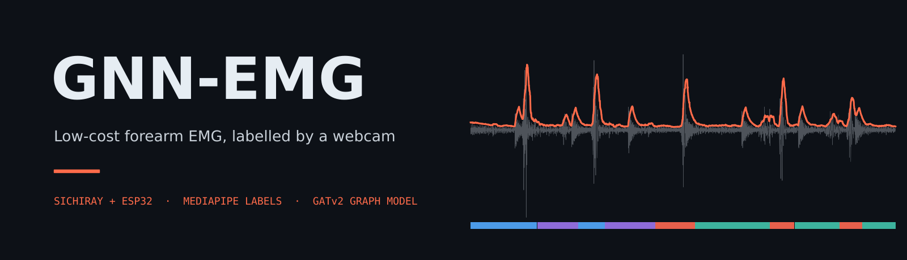
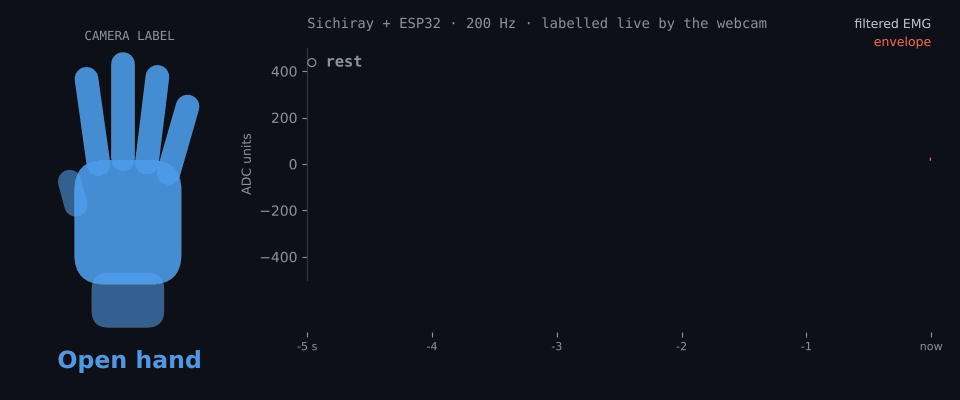
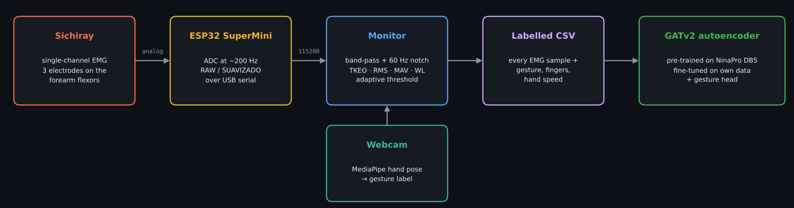
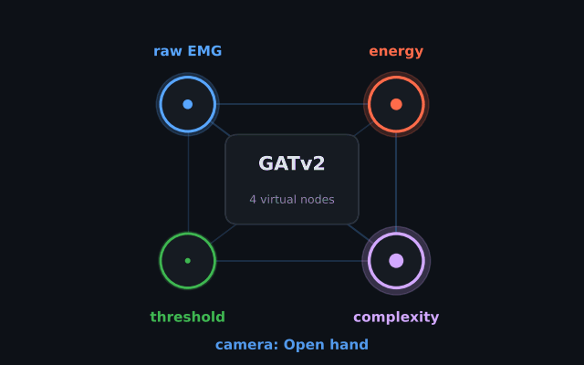
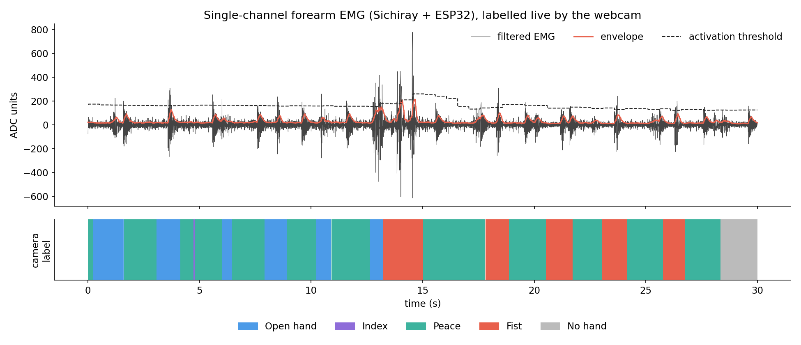
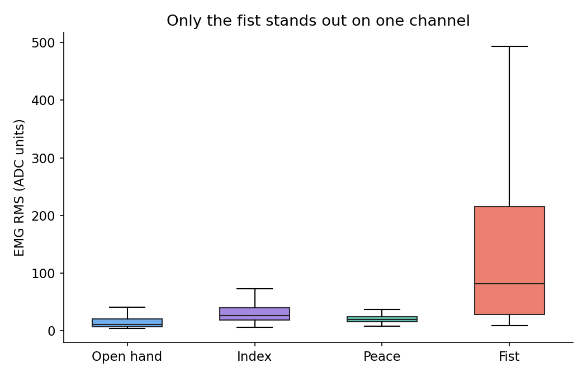
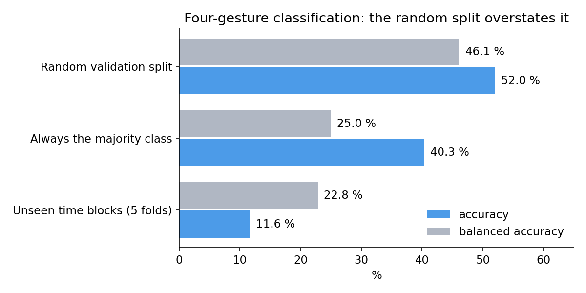
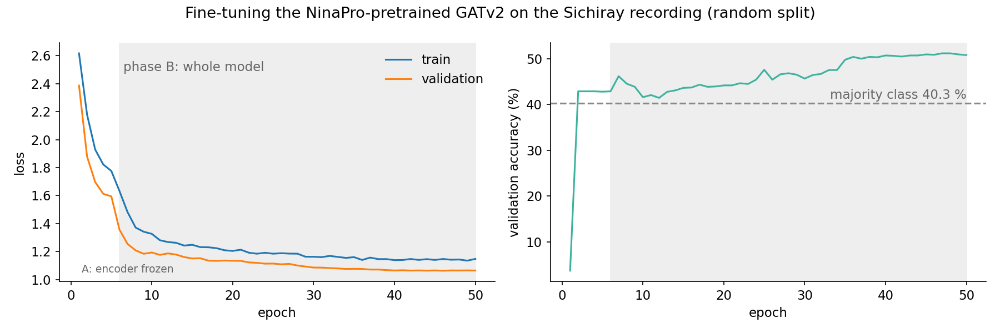

<div align="center">



<br>

**A single-channel muscle sensor, an ESP32 and a webcam: make gestures in front of the camera and every
EMG sample is labelled for you.**

[](LICENSE)


[How it works](#how-it-works) · [Hardware](#hardware) · [Results](#results) · [Usage](#usage) · [Next steps](#next-steps)

</div>

---

<p align="center">
  
</p>
<p align="center"><sub><b>15 real seconds of the training recording.</b> Left: the gesture the webcam saw (drawn from the finger
states MediaPipe detected). Right: the filtered EMG, its envelope and the label each sample was saved with.</sub></p>

## Highlights

<table>
<tr>
<td width="50%" valign="top">

### 🔌 Under-the-desk hardware
One **Sichiray** EMG module and an **ESP32 SuperMini** sampling at ~200 Hz over USB serial. No
lab amplifier, no acquisition software.

### 📷 Labels for free
`gesto_mano.py` recognises the hand pose from the webcam (open hand, fist, index, peace, OK, thumbs
up/down, three, pinch, phone). Recording a dataset is just making gestures.

</td>
<td width="50%" valign="top">

### ⚡ Real-time processing
Band-pass and 60 Hz notch, Teager–Kaiser energy, RMS, MAV, waveform length, zero crossings, envelope,
adaptive activation threshold with debounce, SNR.

### 🕸️ Graph model for one channel
A **GATv2 graph autoencoder** pre-trained on NinaPro DB5 (16 channels as nodes); for one channel, feature
groups become virtual nodes.

</td>
</tr>
</table>

## How it works

<p align="center">
  
</p>

- **Acquisition:** the ESP32 samples the sensor at ~200 Hz and streams `RAW:<value>,SUAVIZADO:<value>`
  lines over USB serial (115 200 baud).
- **Real-time signal processing** (`monitor_emg_gesture.py`): filtering, energy and time-domain features,
  activation detection and SNR on every sample.
- **Automatic labelling:** every EMG row is saved together with the gesture, finger states and hand speed
  from the webcam.
- **Model** (`gnn_emg/`): GATv2 graph autoencoder with a gesture head. Camera features are masked at the
  model input so the classifier cannot read the label from them.
- **Real-time inference** (`gnn_emg/inference/realtime.py`) with a virtual-hand display.

<table>
<tr>
<td width="45%"></td>
<td width="55%" valign="middle">

### One channel, four virtual nodes

NinaPro DB5 has 16 electrodes, so in pre-training each channel is a graph node. The Sichiray gives
one signal, so its features are grouped into **virtual nodes**:

| Node | Features |
|:---|:---|
| <b>raw EMG</b> | raw, smoothed, filtered |
| <b>energy</b> | TKEO, RMS, MAV |
| <b>complexity</b> | waveform length, zero crossings, envelope, rectified |
| <b>threshold</b> | muscle active, time active, % active, SNR |

<sub>Each node glows with the level of its features in the same 15 s as the animation above.</sub>

</td>
</tr>
</table>

## Hardware

| Part | Notes |
|---|---|
| Sichiray single-channel EMG module | 3 electrodes: two over the muscle, one reference on bone |
| ESP32 SuperMini | Analog output of the module → an ADC pin; USB serial to the PC |
| Webcam | Only needed for labelling |

> [!TIP]
> **Electrode placement:** on the **forearm flexors** (palm side, 3–4 finger widths below the elbow
> crease), the two active electrodes 2–3 cm apart along the muscle, the reference on the elbow or wrist
> bone.

The ESP32 firmware is not included in this repository; any sketch that prints the line format above works.

## Results

<p align="center">
  
</p>

<table>
<tr>
<td width="50%"></td>
<td width="50%"></td>
</tr>
<tr>
<td align="center"><sub><b>One channel sees the fist.</b> Mean RMS ≈ 180 vs 24–38 for the other gestures.</sub></td>
<td align="center"><sub><b>A random split overstates the model.</b> On unseen time blocks it falls below the majority class.</sub></td>
</tr>
</table>

`scripts/evaluate_splits.py` evaluates the classifier three ways:

<div align="center">

| Evaluation | Accuracy | Balanced accuracy |
|:---|:---:|:---:|
| Released model, random validation split | 52.0 % | 46.1 % |
| Always predicting the majority class | 40.3 % | 25.0 % |
| Same training, validation on separate time blocks (5 folds) | 11.6 % | 22.8 % |

</div>

- ✅ **What works reliably:** the acquisition chain, real-time processing and activation detection, and the
  camera-based labelling pipeline.
- ⚠️ **Random split vs. time blocks.** With a random split, validation windows overlap (50 %) and sit next
  to training windows from the same recording, which inflates the score. On **unseen time blocks** the
  model does not generalise across the four gestures. Part of the drop also comes from the class mix
  changing between blocks, because gestures were recorded in runs.
- ⚠️ **One channel cannot separate finger gestures.** Index, peace and open hand use muscles that a single
  electrode pair barely distinguishes. Multi-class gesture recognition usually uses 8–16 channels
  (NinaPro DB5 has 16).
- ⚠️ **Real-time inference computes its features differently** from the recordings (other filter, fixed
  SNR and activity values). With those features the model predicts *fist* for every window, so in
  practice the live display separates **rest from contraction** through its RMS threshold.

> [!IMPORTANT]
> Rest vs. contraction is the realistic target for one channel. Finger gestures need more channels — see
> [Next steps](#next-steps).

<details>
<summary><b>Fine-tuning curves (NinaPro-pretrained GATv2 on the Sichiray recording)</b></summary>
<br>



</details>

## Installation

```bash
git clone https://github.com/SlightlyDazed/gnn-emg.git
cd gnn-emg
python -m venv .venv && source .venv/bin/activate
pip install -r requirements.txt
# MediaPipe hand model (needed by the monitor)
python -c "import urllib.request; urllib.request.urlretrieve('https://storage.googleapis.com/mediapipe-models/hand_landmarker/hand_landmarker/float16/latest/hand_landmarker.task','hand_landmarker.task')"
```

On Linux the serial port needs permissions: `sudo usermod -aG dialout $USER` (Debian/Ubuntu) or
`uucp` (Arch), then log in again.

## Usage

```bash
python monitor_emg_gesture.py --list                      # find the ESP32 port
python monitor_emg_gesture.py --port /dev/ttyACM0         # live EMG + camera, records CSV to ./dataset
python monitor_emg_gesture.py --demo                      # without hardware

python -m gnn_emg.train.finetune_sichiray                 # fine-tune on ./dataset
python -m gnn_emg.inference.realtime --port /dev/ttyACM0  # real-time inference (--demo without hardware)
python scripts/evaluate_splits.py                         # evaluation above
python docs/make_readme_media.py                          # regenerate the README animations
```

Pre-training (`python -m gnn_emg.train.pretrain_ninapro`) expects NinaPro DB5 `.mat` files in
`NinaPro/db5/`.

## Data

| Path | Content |
|---|---|
| `dataset/` | The recording used for fine-tuning (523 s, 104 352 samples; open hand, fist, index, peace) |
| `data/raw/` | All original recordings, gzip-compressed, with the labels exactly as the camera produced them |

<details>
<summary><b>Why <code>OTRO</code> became open hand in the training file</b></summary>
<br>

In the training file, the rows the camera labelled `OTRO` (no gesture recognised) were relabelled as
`ABIERTA` (open hand): in that session the thumb was never detected as extended (the thumb test in
`gesto_mano.py` depends on handedness and image orientation), so an open hand was never recognised.
About 79 % of those rows show four extended fingers; the rest are other poses.

</details>

## Next steps

- [ ] Compute features with one shared function for recording, training and real-time inference.
- [ ] Validate across sessions (train on some recordings, test on others).
- [ ] Make the thumb test independent of image mirroring.
- [ ] Add 2–4 Sichiray modules on different forearm muscles (more ESP32 ADC pins) for finger gestures.

<details>
<summary><b>Repository structure</b></summary>

```
monitor_emg_gesture.py   real-time EMG + camera monitor and recorder
gesto_mano.py            MediaPipe hand-gesture recognition
gnn_emg/                 model, datasets, training, real-time inference, config, checkpoints, logs
scripts/                 evaluation
dataset/, data/raw/      recordings
docs/                    README images and animations, and the script that renders them from dataset/
legacy/                  earlier versions of the monitor
```

</details>

## License

[MIT](LICENSE). The MediaPipe hand model is distributed by Google under Apache 2.0; NinaPro is
available from its authors under its own terms.
